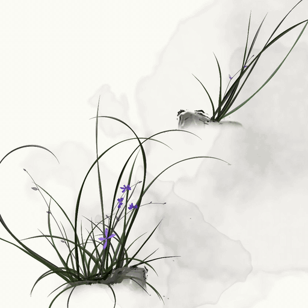
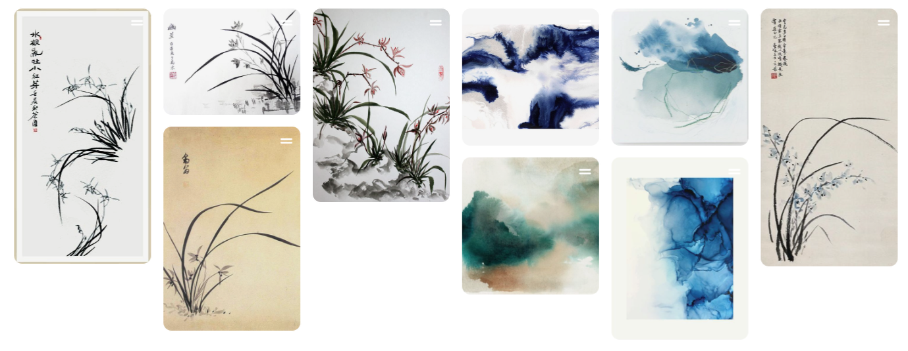
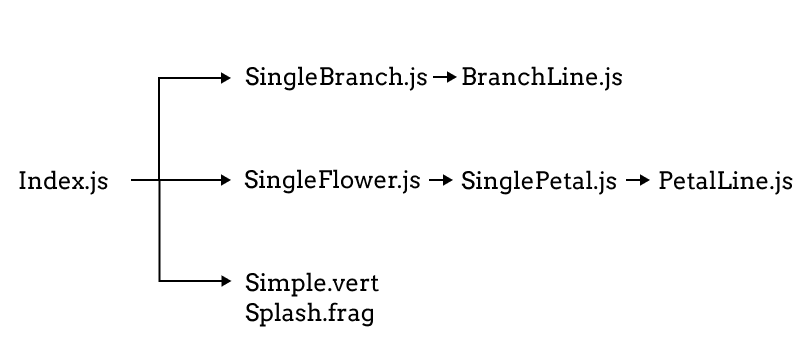
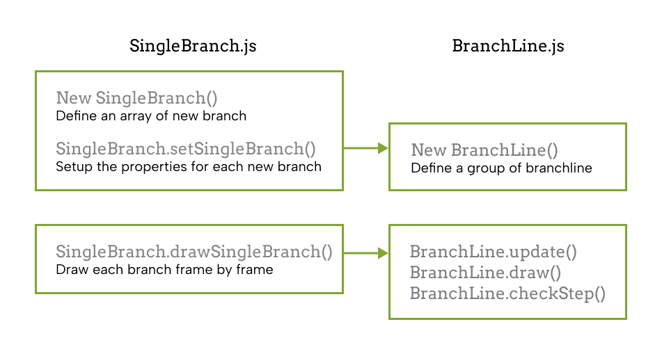
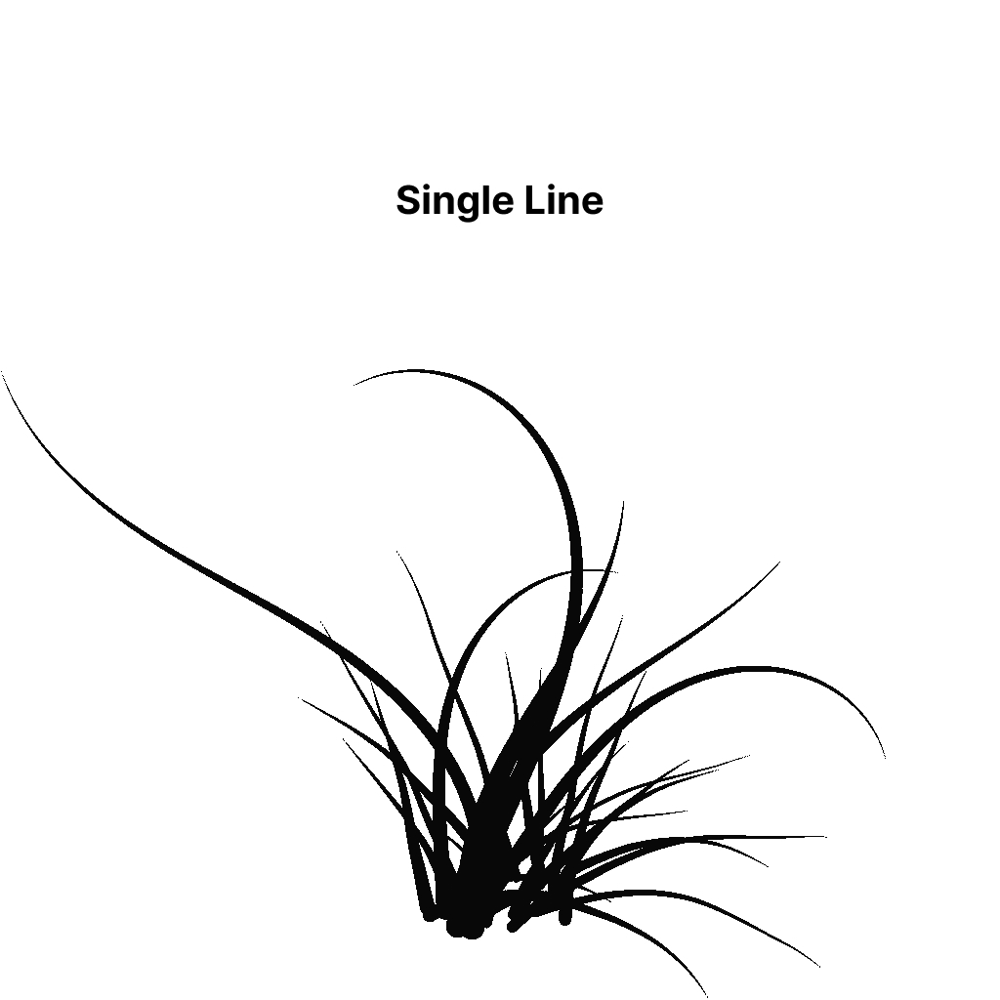
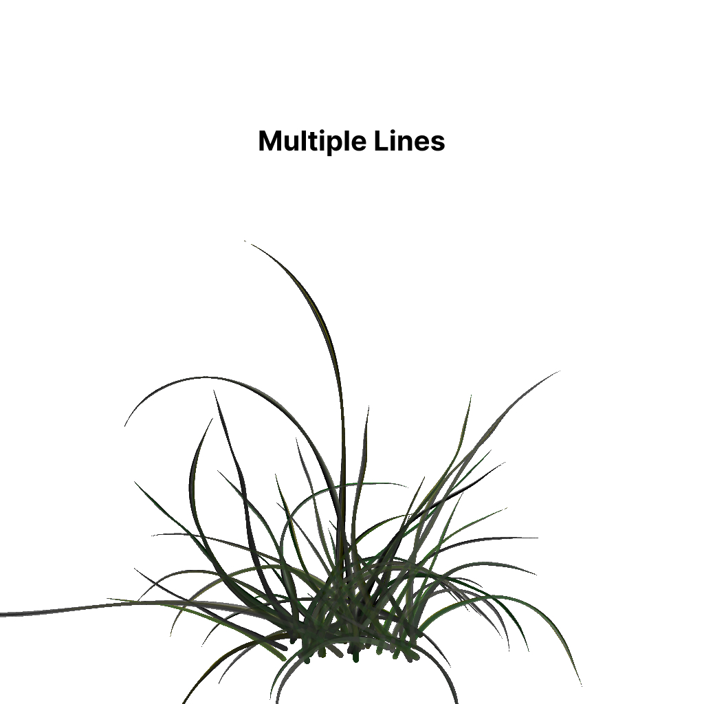
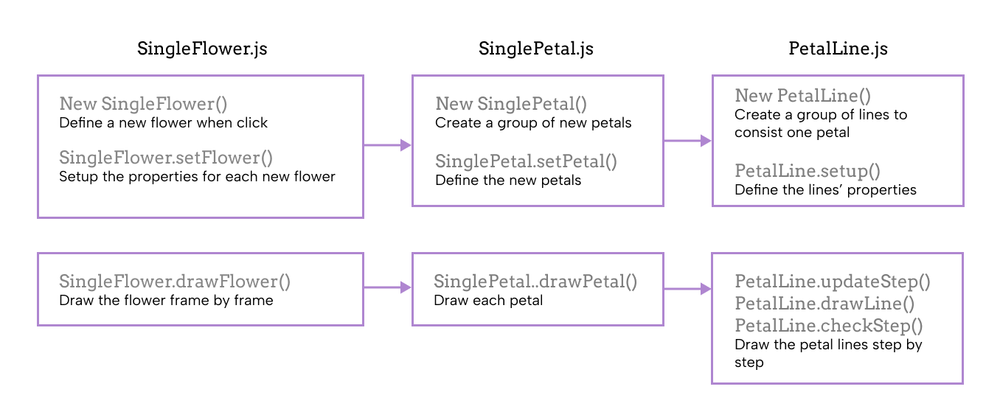
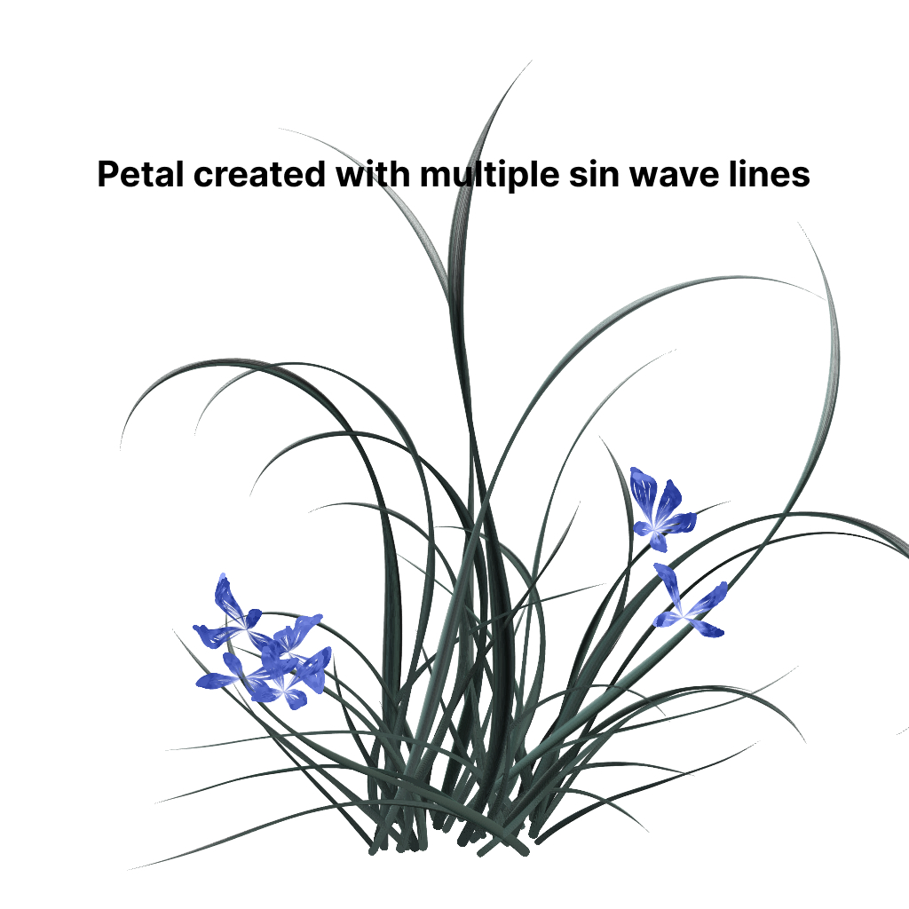
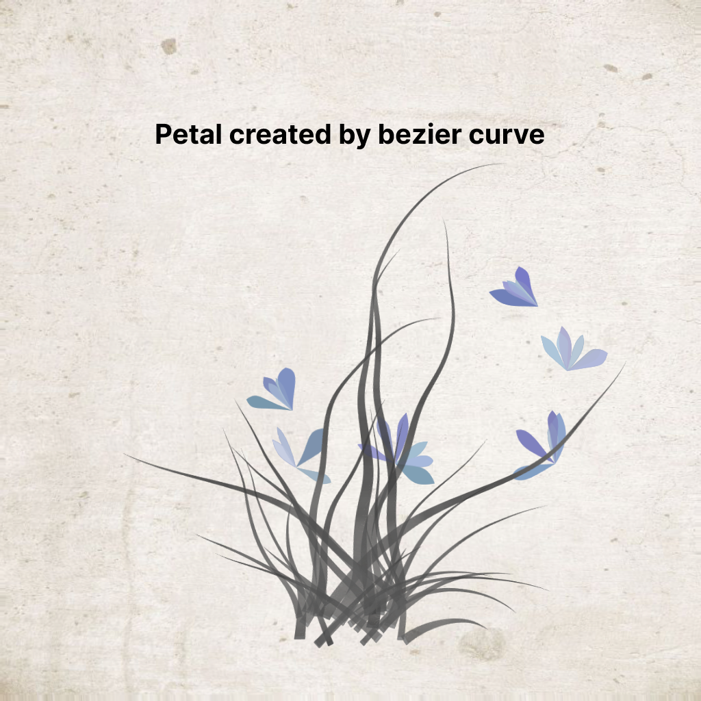

# Lan Flower Sketch 

The flower deity for July in traditional Chinese culture is the Orchid flower, which is "Lan" in Chinese. Lan flower hold a special place in Chinese aesthetics and symbolism, often representing elegance, nobility, grace, and integrity. And the qualities represented by the flower deity symbolizes the characteristics possessed by those born in this month. 

I am not good at painting, but want to use my own skills to draw these beautiful plants. And the painting is dynamic, which means the lan will grow differently every time you see it: wild orchids growing aslant out of rock crevices in a valley, slender and unruly, with a flower here and there.

You can preview the effect on 
https://anyemelody.github.io/LanSketch/

## Interaction
1. The leaves and the flower stalks grow when the page opens, then keep swaying in a light breeze. Long leaves are floppier than short ones, and every leaf has its own rhythm.
2. Click the canvas and a gust blows through: leaves and stalks near the click are pushed away, swing back a few times and settle.
3. Flowers sit on the stalks as closed buds. One or two open by themselves; every click opens the bud nearest to it. The petals grow outward from the heart of the flower.

The `background` panel in the top right corner changes the ink wash behind the orchid: how dark it gets, how far it bleeds, the tide line it leaves as it dries, the paper grain, the colour, and how fast it drifts.

Add `?seed=123` to the address to see the same picture again (the seed of the current picture is printed in the console), and `?record` to get a button that saves a video of the canvas.

## How to use
The effect is written by using tools like [canvas-sketch](https://github.com/mattdesl/canvas-sketch), [p5.js](https://p5js.org/), and glsl. All original js files are in `src` folder. 
If you download the `src` folder, use commonds to preview the effect: 

`canvas-sketch index.js --open`

## Inspiration

## Diagram
The project started with three components: the flower, the branch and the background effect. Each component has its own distinct behaviors and characteristics.

Since then the picture has grown, and the code now has these parts:

| File | What it does |
|---|---|
| `index.js` | Picks the composition, builds everything and draws the layers every frame |
| `SingleBranch.js`, `BranchLine.js` | The shape of one leaf: a bundle of lines that walk, pinch together and part |
| `LeafMesh.js` | Keeps all the leaves as one mesh and redraws it every frame, so they can sway |
| `SingleFlower.js`, `SinglePetal.js`, `PetalLine.js` | The shape of one flower: 4 or 5 petals, each a set of sine-shaped lines |
| `FlowerStalk.js`, `FlowerMesh.js` | The jointed stalks, the flowers and buds on them, their sway and their blooming |
| `Rock.js`, `RockLine.js` | The ink stones the orchids grow from |
| `splash.frag` | The ink wash background |

### Composition
Each picture has two or three clumps. They are placed by a few layouts borrowed from ink painting: one host and smaller guests, never at the same height, never evenly spaced, three clumps on an uneven triangle, and a large part of the paper left empty. The clumps higher up are smaller. Every clump leans to one side, and a clump near the edge may grow out of the picture.

Every clump also gets its own habit, so a picture mixes them: `full` is an open clump with many leaves, `loose` has fewer, and `few` is only a handful of long leaves bunched together and swept to one side.

### Rock
A stone is painted in three steps, light to dark. First a pale wash inside its shape, darker under the top edge and fading to nothing at the foot, with a tide line where the ink dried. Then a few dark brush strokes for the contour: broken, thick and thin, mostly along the top and the shaded side, and never around the foot, so the shape stays open. Last a few details: dry texture strokes, a dark touch in a cleft, some moss dots. Every stroke is a bundle of fine hairs that lift off the paper where a noise field dips, which gives the dry-brush look.

There are six kinds of stone (boulder, slab, block, a pair with the orchid in the gap, stacked, overhang). None of them has a pointed top: these are stones, not mountains.

### Background
`splash.frag` lays twelve drifting washes of ink over each other. Before they are laid, noise pushes the coordinates around so the edges feather like ink creeping into wet paper. Some washes have a soft edge and some a crisp one, each keeps a little more pigment just inside its edge (the tide line), and the pigment settles unevenly into the grain of the paper.

### Branch Design
Here is a detailed explanation of the branch component. So the `SingleBranch.js` defines each single branch, meanwhile each single branch consists of several lines that defines in `BranchLine.js`. The reason to use several lines to consist one branch is I want more dynamic colors for each branch.

In the first version each line was drawn a little further every frame on a canvas that was never cleared, so a leaf could not move once it was painted. Now every line is run to its end when the page opens and its points are kept. `LeafMesh.js` turns them into one mesh and draws it every frame; the sway happens in the vertex shader, where each point is turned around the root of its leaf, a little near the root and more toward the tip.

	

### Flower Design
In order to make the flower has more dynamic shape and color, each flower consist of 4 or 5 petals. Meanwhile each petal consists of a set of lines. The line has the basic shape of sin wave with some noise on the curve. The color of the lines are changing according to the line position to create the gradient effect.

The flowers used to be painted where you clicked. Now they grow on stalks: each stalk has a few nodes with one flower each, often ending in a closed bud or two. Like the leaves, the petal lines are computed once and kept, so a flower can ride its stalk as it sways and open by letting its lines grow out from the heart.

    updateStep() {

    this.theta = this.graphic.map(Math.pow((this.lineStep / this.totalStep), this.curvePow), 0, 1, 0, Math.PI);
    
    //petal thinkness noise
    
    this.curveAmp += (this.graphic.noise(this.ampNoise + this.lineStep * 0.006) - 0.5) * 1.;
    
    this.pos = this.graphic.createVector(this.lineStep * this.petalLength, Math.sin(this.theta) * this.curveAmp);
    
    this.pos = this.pos.add(this.originPos);
    
    this.lineStep++;

    }

	

